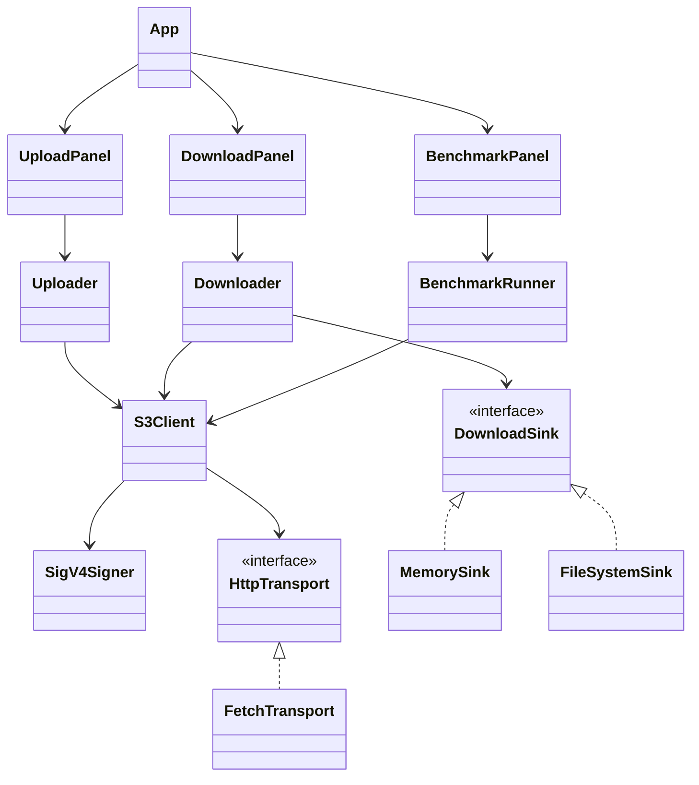

# Blink-web 架构设计

> 本文描述第一版（v0.1）的设计边界、依赖方向与关键不变式。性能数字与测试条件见
> [testing.md](./testing.md)，已知缺陷见 [limitations.md](./limitations.md)。

## 1. 定位

Blink-web 是 Blink（S3 兼容单机存储）的浏览器上传 / 下载测试台：

- 在浏览器内完成 SigV4 签名，经**同源透明代理**访问固定后端；
- 提供桶管理、前缀浏览、单 PUT / 分片上传、Range 流式下载、对象详情与删除；
- 内建浏览器压测面板，并提供复用同一客户端核心的 Node 压测 CLI；
- 不持有、不转发、不落盘任何 secret。

**非目标**：多端点 / 多租户、ACL、版本控制、跨会话断点续传、预签名分享、对象预览。
Blink 当前对这些能力返回 `501` 或不支持，前端不伪造入口。

## 2. 决定实现的协议约束

| 约束 | 架构后果 |
| --- | --- |
| Blink v0.1 不含 CORS；桶级 CORS 由后续 `feature/cors` 切片提供 | 本前端仍以同源代理为唯一部署形态，不假定任意 S3 端点可直连 |
| 签名中的 `host` 取后端 `r.Host` | 代理必须保留浏览器原始 `Host`，不能改写成后端地址 |
| CanonicalURI 使用原始编码路径，不解码、不 Clean | 代理只做字符串前缀剥离；客户端与代理共享同一份编码结果 |
| `x-amz-content-sha256` 必须参与签名 | 浏览器用 WebCrypto 计算真实 SHA-256；空体用固定空哈希 |
| PUT / UploadPart 需要确定的 `Content-Length` | 请求体使用 `Blob` / `Uint8Array`，不使用流式请求体 |
| 非末片 ≥ 5 MiB，编号 1–10000，Complete 严格升序 | 默认 8 MiB 分片，并发上传后按序提交 |
| MPU 的 SHA-256 是 COMPOSITE（`-N`） | 界面显示 `x-amz-checksum-type`，不宣称等于整文件 `shasum` |
| 浏览器 HTTP/1.1 每源约 6 个连接 | 全局 `Semaphore(4)`；浏览器压测数字不能当权威吞吐 |
| `crypto.subtle` 与 File System Access API 需要安全上下文 | 启动检查 `isSecureContext`；下载按能力选择写盘方式 |

## 3. 与主流方案对比

| 方案 | 凭据位置 | 运行形态 | 借鉴 | 放弃 |
| --- | --- | --- | --- | --- |
| MinIO Console | 服务端 BFF 持有 | 自带后端的完整管理台 | 功能分区、对象浏览交互 | 服务端持有凭据、重型前端栈 |
| AWS S3 Console | 云会话 | SaaS | 前缀导航、分页语义 | 离开 AWS 不可用 |
| Cyberduck / S3 Browser | 桌面应用本地 | 原生 GUI | 以文件传输为中心 | 需要安装客户端 |
| Filestash / rclone Web UI | 服务端持有 | BFF Web UI | 浏览器体验 | 凭据落在服务器 |
| s5cmd 等 CLI | 本地 | 命令行 | 压测指标口径、批量操作 | 无可视化 |
| 本项目 | **浏览器内存** | 静态页 + 同源透明代理 | 上述交互与指标口径 | 不作为通用多租户控制台 |

本项目的差异点不是"功能更多"，而是把**签名、传输策略、压测**放在同一套可测试的
客户端核心里，并让服务端只做不接触凭据的透明转发。

## 4. 总体结构

```text
┌──────────────────────────── 浏览器 ────────────────────────────┐
│ App（组合根）                                                   │
│   ├─ ConnectionPanel / BucketList                               │
│   ├─ ObjectBrowser                                              │
│   ├─ UploadPanel ──► Uploader ──┐                               │
│   ├─ DownloadPanel ─► Downloader ┼─► S3Client ─► SigV4Signer    │
│   └─ BenchmarkPanel ► BenchmarkRunner ┘        └─► HttpTransport│
│                                                       │         │
└───────────────────────────────────────────────────────┼─────────┘
                                     fetch('/s3/...')   │
┌──────────────────────────── Node 服务端 ──────────────▼─────────┐
│ 静态文件（dist） + createS3Proxy                                 │
│   剥离 /s3 前缀、保留 Host、拒绝空段/点段、原样转发               │
└───────────────────────────────────────────────────────┬─────────┘
                                                        │
                                              BLINK_ENDPOINT
                                                        ▼
                                                   Blink 单机
```

"零 BFF"的准确含义是**无凭据 BFF**：代理仍在服务端运行，但它不持有密钥、不理解
S3 语义、不做签名重写，只转发字节流。它不是开放代理——目标地址只来自服务端环境变量。

## 5. 类与依赖



依赖方向是单向的：

- `S3Client` 只负责协议：每个 S3 操作一个方法，解析 XML / 错误，不含重试、并发、
  进度策略。
- `Uploader` / `Downloader` / `BenchmarkRunner` 只依赖 `S3Client` 接口形状，承担
  分片、并发、取消、进度、预算等策略。
- UI 是组合根：`App` 构造视图并注入 `onStatus`、`onNavigate` 等回调；视图之间不
  互相引用，不共享全局可变状态。
- `HttpTransport` 与 `DownloadSink` 是替换点，便于单测与未来的中继 / 边端路由。

### 5.1 签名与发送共用一份编码

`SigV4Signer.sign(request)` 返回 `SignedRequest`（最终 URL + 头部）。`S3Client`
把同一份 `SignedRequest` 交给 `FetchTransport`，不会重新拼接或编码 URL。这避免了
"签名时按一种规则编码、发送时按另一种规则编码"的典型 403。

### 5.2 并发模型

- 上传和下载共享全局 `transferPool = Semaphore(4)`，避免多个面板同时打满浏览器
  每源连接数。
- 压测不复用 `transferPool`：`BenchmarkRunner` 自己维护并发波次，才能准确测出
  指定并发下的延迟与吞吐。
- 停止统一使用 `AbortSignal`，重试是纯函数 + 配置，不引入额外的取消令牌类。

## 6. 关键流程

### 6.1 连接与请求签名

1. 用户填写 access key / secret / region；secret 只保存在内存。
2. `ListBuckets` 作为连通性检查：成功即代表代理、Host 保留、签名路径全部正确。
3. 每个请求固定签 `host;x-amz-content-sha256;x-amz-date`：
   - `host` 取 `location.host`（浏览器视角即代理的 Host）；
   - PUT 使用真实正文 SHA-256，其余请求使用空体哈希；
   - query 参数先按 AWS 规则编码，再按编码后的字节排序。
4. `FetchTransport` 一律使用 `redirect: 'error'`，避免 307 把签名路径带到别处。

代理侧只做三件事：剥离固定前缀、保留原始 `Host`、复制其余头与字节流。它拒绝绝对
形式 URL、空字符、空段和 `.` / `..` 段，因为这些路径会被 Go `ServeMux` 307 规范化，
导致签名路径与后端看到的路径不一致。

### 6.2 上传

- `≤ 8 MiB`：单 `PutObject`，带 `x-amz-checksum-sha256` 和真实 SHA-256。
- `> 8 MiB`：`CreateMultipartUpload` → 每片 8 MiB 并发 4 → `UploadPart`（每片带
  校验和）→ 按编号升序 `CompleteMultipartUpload`。
- 分片失败按 `RetryPolicy` 重试；取消或最终失败时 `AbortMultipartUpload`，不留下
  悬挂 upload。
- 界面显示已完成片数，不伪造字节级上传进度——`fetch` 没有上传进度事件。
- 空文件使用 `Blob([])` / `null` 发送，避免被写成 `text/plain` 的非空正文。

### 6.3 下载

- 两个入口共用同一条链路：对象行的「下载」，以及点对象名打开详情后的「下载对象」。
  详情弹窗必须提供下载按钮——点对象名是最自然的动作，不能让用户停在只读详情里。
- 默认 4 MiB Range 顺序读取；每块带 `If-Match`（ETag），防止对象在下载过程中被
  替换后拼出混合内容。
- 优先 `showSaveFilePicker` + `createWritable` 流式写盘，内存占用与对象大小无关；
  保存对话框打开期间任务显示「等待系统保存对话框…」，状态栏同步提示确认位置。
- 不支持 File System Access API 时回退 `MemorySink`，并限制 256 MiB；超过上限明确
  拒绝，而不是冒 OOM 风险。
- 下载器逐块核对实际读取长度，短读直接报错，不把截断文件当完整文件；浏览器内不
  额外计算整文件 SHA-256，完整性对照由集成 / e2e 测试完成。

### 6.4 压测

浏览器面板与 Node CLI 复用 `BenchmarkRunner`，避免"UI 客户端"和"压测客户端"两套
实现。

- **每个样本数据唯一**：会话盐 + 样本序号 + xorshift 生成正文。Blink 按内容寻址
  去重，重复数据会让写入量、吞吐和块占用全部失真。
- **warmup 默认 10%**，先完成一个最小并发波次，再进入测量。
- **停止条件**：样本数达到目标，或测量时长达到上限（完成一个波次后检查），先到
  先停；因此大对象在预算 / 时长约束下可能少于目标样本，报告会标记 `budgetLimited`。
- **写入预算**：按对象尺寸均分，`reserveWrite` 在发请求前扣减，失败请求也计入
  已占用预算，避免重试把磁盘打满。浏览器面板总预算 256 MiB，CLI 默认总预算
  512 MiB。
- **指标**：p50 / p95 / p99 / min / max / mean、吞吐、错误分类、校验和不一致数；
  错误连续达到上限即停止，保留已测样本。
- **清理**：面板只删除 `onObjectCreated` 记录的 key；CLI 在 `--spawn` 模式下每个
  尺寸使用独占临时数据目录，结束后整目录删除，避免块文件在紧张磁盘上累积。

### 6.5 错误与取消

- `S3Error` 保留 HTTP 状态与 S3 `Code`；`TransportError` 表示网络层失败；
  `AbortError` 单独识别。
- UI 通过 `describeError` 展示可操作信息，不打印 `Authorization` 或 secret。
- 取消、断开连接、切换桶都会 abort 在途请求；压测在断开后仍用运行开始时捕获的
  客户端清理已写入对象。

## 7. 设计主张

以下是设计选择，不是未经对照实验的"性能优势"结论：

1. **代理不重写签名**：保留 Host + 逐字节路径转发，使浏览器签名的 canonical
   request 与后端看到的请求一致；代理不需要成为 SigV4 的第二实现。
2. **一套核心，两种入口**：UI、集成测试、Node CLI 都走 `S3Client`，压测结果和
   界面行为不会因为客户端分叉而漂移。
3. **大文件优先**：分片并发上传、Range 顺序下载、流式写盘、SHA-256 校验，针对
   上游模型文件这类"大、不可重来、需要完整性证明"的对象。
4. **压测内建**：浏览器面板用于快速冒烟，Node CLI 用于可复现的权威基线；两者明确
   区分，不把每源 6 连接的浏览器数字当服务端吞吐。
5. **边端入口在传输层**：`HttpTransport` 是接口，未来加 `RelayTransport` 即可把
   请求路由到多台边端节点，UI 与上传 / 下载策略不需要改。

## 8. 边端分布式扩展入口

当前版本是单端点：`BLINK_ENDPOINT` 指向一台 Blink。为未来边端分布保留的边界：

```ts
export interface HttpTransport {
  send(req: HttpRequest): Promise<HttpResponse>
  stream(req: HttpRequest): Promise<HttpStreamResponse>
}
```

可扩展点：

- **`RelayTransport`**：实现同一接口，按桶 / 租户 / 区域选择边端节点，或在节点间
  转发；`S3Client`、`Uploader`、`Downloader` 无感知。
- **路由键**：桶名或对象前缀天然可作为 placement key；第一版不引入元数据服务，
  避免在单机阶段过早承担一致性成本。
- **CLI 复用**：`scripts/bench.ts` 已支持 `--endpoint` 与 `--spawn`，可以对任意
  边端节点跑同一套指标。
- **未来需要补齐的能力**：节点注册与健康检查、桶到节点的映射、跨节点 GC 协调、
  离线队列与冲突解决。这些都不在本版本承诺范围内。

## 9. 安全模型

- **secret 永不持久化**：只存在内存；可选的 sessionStorage 仅保存 access key 与
  region，且默认关闭。e2e 会断言 sessionStorage 中不出现 secret。
- **代理不额外鉴权**：能访问代理就能访问后端。默认只监听 `127.0.0.1`；部署到
  其他地址时必须置于 TLS 与认证反向代理之后，且反向代理要保持 `Host`。
- **响应头**：生产服务器下发 CSP（`default-src 'self'`、`connect-src 'self'`、
  `object-src 'none'`、`frame-ancestors 'none'`）、`nosniff`、`no-referrer`、
  `X-Frame-Options: DENY`。
- **日志**：代理只记录方法、路径、状态与耗时，不记录请求头，不记录
  `Authorization`。
- **明文 HTTP**：凭据与正文可被同网段窃听；仅建议 localhost 或 TLS 终止之后使用。

## 10. 可测试性

- 核心模块不依赖 DOM：签名、编码、XML、上传 / 下载规划、重试、压测均可在
  `node:test` 中直接测试。
- `S3Client` 通过 `HttpTransport` 注入，单元测试用内存替身记录请求。
- 集成测试启动真实 Blink（临时数据目录、假凭据）；二进制缺失时明确跳过，不静默
  通过。
- e2e 用 Puppeteer 驱动真实 Chrome，覆盖连接 → 建桶 → 浏览 → 上传 → 下载 →
  删除 → 压测面板 → 断开 → 重连 → 删桶。
- 压测结果 JSON 保存在 `bench-results/`（gitignore），摘要与环境绑定信息写入
  [testing.md](./testing.md)。
